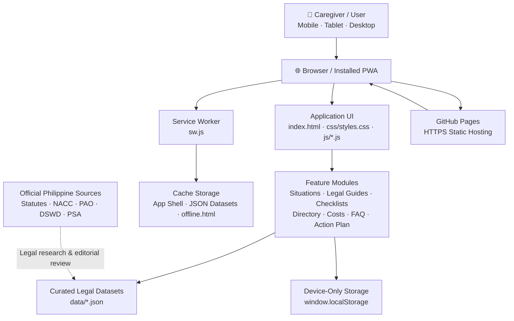

<p align="center">
  
</p>

<h1 align="center">AlagaLegal PH</h1>

<p align="center">
  <strong>Clearer legal information. Safer family-care decisions.</strong><br />
  A community-focused Progressive Web App for Filipino families and caregivers.
</p>

<p align="center">
  <a href="https://githubbest729.github.io/AlagaLegal-PH/">
    
  </a>
  
  
  
</p>

> **Mission:** "Nobody should have to break the law simply because they cannot afford to understand it."

**Live application:** <https://githubbest729.github.io/AlagaLegal-PH/>

---

## 📌 About the Project

AlagaLegal PH is a free, open-source Progressive Web App designed to help grandparents, aunts, uncles, guardians, and other caregivers understand lawful family-care options and navigate Philippine government procedures safely.

The project addresses common barriers faced by informal caregivers:

- Lack of clear, accessible legal information in everyday language.
- Confusion between adoption, judicial guardianship, substitute parental authority, and informal custody.
- Incomplete or incorrect documentary requirements when visiting government offices.
- Limited awareness of free legal aid (PAO, IBP) and social welfare services (LSWDO, NACC, DSWD).
- Risk of relying on misinformation or harmful shortcuts—such as falsifying birth certificates ("simulated birth")—that endanger a child's legal identity, schooling, passport, and inheritance rights.

The app is an **educational information and navigation tool**, not a law firm, legal representative, government agency, or substitute for advice from a qualified Philippine lawyer or the appropriate government office.

## 🎯 Goals

1. Explain Philippine family-care laws and procedures in plain **English and Filipino**.
2. Help caregivers identify the right questions to raise with social workers, civil registrars, or lawyers.
3. Organize document-preparation tasks with offline-persistent interactive checklists.
4. Connect families exclusively to verified official government portals and legal aid offices.
5. Keep essential guidance fast, private, and usable on mobile phones—even without an internet connection.

## 🧭 App Modules

| Module | Implemented Functionality |
| :--- | :--- |
| **Family Situation Guide** | Interactive situation matcher for grandparents, aunts/uncles, foundling caregivers, relatives, guardians, prospective adopters, and families fixing birth records—showing lawful options, child-protection warnings, and links to checklists. |
| **Step-by-Step Legal Guides** | Searchable, filterable English/Filipino guides covering **RA 11642** (Domestic Administrative Adoption), **Family Code Arts. 214 & 216** (Substitute Parental Authority), **A.M. No. 03-02-05-SC** (Judicial Guardianship), **RA 9048 / RA 10172 / RA 9255** (Birth Certificate Corrections), and **RA 11767** (Foundling Protection), with **Read Aloud (`🔊`)** audio and print support. |
| **Document Checklists** | Per-procedure interactive checklists saved privately on the user's device via `localStorage`, complete with completion percentage tracking, document sources, and office-verification flags. |
| **Legal Aid Directory** | Searchable directory of **NACC / RACCO**, **PAO**, **DSWD**, **LSWDO** (Bataan Community Guide & Nationwide LGUs), **LCRO**, **PSA** (including E-Certificate Services), and **IBP Legal Aid**, linking only to official `.gov.ph` / `ibp.ph` portals. |
| **Cost & Process Guide** | Transparent stage-by-stage breakdown distinguishing free public services (PAO, LSWDO, NACC administrative adoption) from potential documentary or publication expenses requiring local confirmation. |
| **FAQs** | Searchable answers to common caregiving questions (grandparent adoption, separated parents, unreachable biological parents, guardianship vs. adoption, birth certificate errors, and indigent legal aid) with statutory citations and verification dates. |
| **Personal Action Plan** | Device-only caregiver planner to save a chosen family situation, track next-step tasks, and store private notes locally with zero server uploads. |

> **Verification Note:** Dates labeled `Verified` inside the app indicate when statutory citations were checked against official Philippine government sources (such as the Official Gazette, Supreme Court E-Library, NACC, and PSA). Local office schedules, intake rules, and municipal/court fees vary and must always be confirmed directly with the specific office.

## 🏛️ System Architecture

AlagaLegal PH runs as a 100% static, client-side Progressive Web App hosted on GitHub Pages. It requires no backend server, database subscription, or user accounts.



## ✨ Accessibility & Modern PWA Features

- **Offline-First Service Worker (`sw.js`):** Precaches the app shell and legal JSON datasets, uses a network-first strategy for JSON updates when online, and provides a custom `offline.html` fallback.
- **Privacy by Design:** All checklist progress, action plan tasks, and caregiver notes stay exclusively in `localStorage` on the user's device.
- **Senior-Friendly Accessibility:** Includes a one-tap **English ↔ Filipino (`EN → FIL`)** toggle, **`A+` larger reading text mode**, **Light / Dark / System theme switching**, **Web Speech API Read Aloud (`🔊`)** on legal guides, `44×44px+` touch targets, `:focus-visible` keyboard outlines, and `prefers-reduced-motion` support.
- **Native Mobile Polish:** Uses relative `./` paths for GitHub Pages subdirectory compatibility, View Transitions API cross-fades, frosted-glass sticky navigation, iOS Home Screen launch splash screen, and Web Share API (`navigator.share`) for easy sharing via Messenger, Viber, or SMS.

## 📁 Repository Structure

```text
AlagaLegal-PH/
├── index.html                 # Main PWA shell and all 8 views
├── manifest.webmanifest       # PWA metadata, icons, and home-screen app shortcuts
├── sw.js                      # Fault-tolerant offline Service Worker
├── offline.html               # Custom offline fallback page
├── favicon.svg                # Scalable brand emblem
├── generate-icons.html        # In-browser PNG icon generator (no Node.js required)
├── robots.txt                 # Search crawler directives
├── .nojekyll                  # Bypasses Jekyll processing on GitHub Pages
├── LICENSE                    # MIT License
├── README.md                  # Project documentation
├── css/
│   └── styles.css             # Civic design system, responsive grids & print styles
├── js/
│   ├── storage.js             # Device-only LocalStorage wrapper
│   ├── accessibility.js       # Bilingual dictionary (EN/FIL), theme & text-size manager
│   ├── navigation.js          # Hash-based router with View Transitions support
│   ├── legal-guides.js        # Situations, guides, directory & FAQ renderer/filters
│   ├── checklist.js           # Interactive document checklist & progress tracker
│   └── app.js                 # Main controller, Read Aloud TTS, Action Plan & SW lifecycle
├── data/
│   ├── legal-guides.json      # Bilingual step-by-step Philippine legal guides
│   ├── documents.json         # Per-procedure document checklists
│   ├── legal-aid.json         # Verified government & legal aid directory
│   └── faqs.json              # Frequently asked questions with statutory citations
├── icons/                     # PWA PNG icons (icon-192.png, icon-512.png, maskable icons)
└── scripts/
    └── generate-assets.mjs    # Optional zero-dependency Node.js PNG/ICO generator
```

## 💻 Running Locally & Generating Icons

1. **Clone or download the repository:**
   ```bash
   git clone [https://github.com/githubbest729/AlagaLegal-PH.git](https://github.com/githubbest729/AlagaLegal-PH.git)
   cd AlagaLegal-PH
   ```
2. **Generate binary PNG icons (choose either option):**
   - **Browser option (no installation required):** Open `generate-icons.html` in Chrome or Edge, click **Download All PWA PNG Icons**, and place the downloaded PNGs inside `icons/`.
   - **Node.js option (Node 18+):** Run `node scripts/generate-assets.mjs`.
3. **Start a local HTTP server** (required for Service Worker registration):
   ```bash
   python3 -m http.server 8080
   ```
   Open `http://localhost:8080/` in your browser.

## 🚀 Deploying on GitHub Pages & Installing on Phones

### GitHub Pages Setup
1. Push all files to the `main` branch of your GitHub repository.
2. Open **Settings → Pages** in your repository.
3. Under **Build and deployment**, select **Deploy from a branch**, set the branch to **`main`** and folder to **`/ (root)`**, and click **Save**.
4. Access your live app at `https://githubbest729.github.io/AlagaLegal-PH/`.

### Installing as an App
- **Android (Chrome / Edge):** Open the live link and tap **Install App** in the header or **⋮ → Add to Home screen**.
- **iPhone / iPad (Safari):** Open the live link in Safari, tap **Share**, and select **Add to Home Screen**.
- **Desktop (Chrome / Edge):** Click the **Install** icon in the browser address bar.

## 📝 Updating Legal Content & Contributing

All legal guides, checklists, directory entries, and FAQs live in `data/*.json`. When proposing edits or submitting a Pull Request:

1. Cite official Philippine statutes, Supreme Court rules, or government issuances (e.g., RA 11642, Family Code, RA 9048, RA 10172, RA 11767, A.M. No. 03-02-05-SC).
2. Include an official `.gov.ph` (or `ibp.ph`) `sourceUrl` and update the `lastVerified` date (`YYYY-MM-DD`).
3. **Never add unverified phone numbers, street addresses, or exact peso fee tables**, and never suggest falsifying birth certificates or bypassing child-protection laws.
4. Bump `CACHE_VERSION` inside `sw.js` whenever updating cached assets or JSON datasets.

## ⚖️ Legal Disclaimer & License

**AlagaLegal PH is a public-service legal literacy tool, not a law firm or government agency.** Content is provided strictly for general educational purposes and does not constitute legal advice or create an attorney-client relationship. Always consult the **Public Attorney's Office (PAO)**, **National Authority for Child Care (NACC)**, your **Local Social Welfare and Development Office (LSWDO)**, or a licensed Philippine attorney regarding your specific situation.

Released under the [MIT License](LICENSE).
