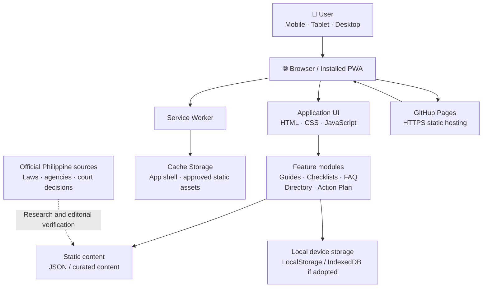

```{=html}
<p align="center">
```
``{=html}
```{=html}
</p>
```
```{=html}
<h1 align="center">
```
AlagaLegal PH
```{=html}
</h1>
```
```{=html}
<p align="center">
```
`<strong>`{=html}Clearer legal information. Safer family-care
decisions.`</strong>`{=html}`<br />`{=html} A community-focused
Progressive Web App for Filipino families and caregivers.
```{=html}
</p>
```
```{=html}
<p align="center">
```
`<a href="https://githubbest729.github.io/AlagaLegal-PH/">`{=html}
``{=html}
`</a>`{=html}
``{=html}
``{=html}
``{=html}
```{=html}
</p>
```
> **Mission:** "Nobody should have to break the law simply because they
> cannot afford to understand it."

**Live application:** <https://githubbest729.github.io/AlagaLegal-PH/>

------------------------------------------------------------------------

## 📌 About the project

AlagaLegal PH is intended to help grandparents, relatives, guardians,
and other caregivers understand lawful family-care options and find
reliable starting points for navigating Philippine government
procedures.

The project responds to common barriers:

-   Lack of clear, accessible legal information.
-   Confusion about adoption, guardianship, custody, and other care
    arrangements.
-   Difficulty understanding document requirements and government
    processes.
-   Limited awareness of free or affordable legal assistance.
-   Risk of relying on misinformation or taking unlawful documentation
    shortcuts.

The app is an **information and navigation tool**, not a law firm, legal
representative, government agency, or substitute for advice from a
qualified Philippine lawyer or the appropriate government office.

## 🎯 Goals

1.  Explain legal concepts in plain English and Filipino.
2.  Help users identify questions to raise with the correct agency or
    lawyer.
3.  Organize document-preparation tasks with practical checklists.
4.  Point users toward official government information and verified
    assistance.
5.  Make essential guidance usable on mobile devices and, where
    supported, offline.

## 🧭 App modules

  -----------------------------------------------------------------------
  Module                              Intended value
  ----------------------------------- -----------------------------------
  Family Situation Guide              Helps users describe their
                                      caregiving situation and explore
                                      general lawful pathways.

  Legal Guides                        Explains relevant processes and
                                      concepts in accessible language.

  Document Checklists                 Helps users track preparation tasks
                                      and questions to verify.

  Legal Aid Directory                 Provides links and contact details
                                      only when verified from reliable
                                      sources.

  Cost & Process Guide                Explains process stages and
                                      distinguishes confirmed fees from
                                      items requiring confirmation.

  FAQs                                Answers common questions with
                                      source links and review dates.

  Personal Action Plan                Lets users organize next steps and
                                      locally saved notes/checklist
                                      progress.
  -----------------------------------------------------------------------

> **Important:** The exact availability and implementation status of
> each module should be checked against the current deployed
> application. This README describes the project goals and intended
> architecture; it does not certify that every feature is already
> implemented.

## 🏛️ System architecture

The intended deployment is a static, client-side PWA hosted on GitHub
Pages. It does not require a custom application server for its basic
information, navigation, and local checklist features.



### Architecture layers

  -----------------------------------------------------------------------
  Layer                               Responsibility
  ----------------------------------- -----------------------------------
  Presentation                        Responsive pages, accessible
                                      controls, navigation,
                                      language/theme preferences.

  Application logic                   Search, guide navigation,
                                      checklists, FAQs, and action-plan
                                      interactions.

  Content                             Curated legal guides, document
                                      lists, FAQs, and directory entries.

  Local persistence                   Saves non-sensitive preferences and
                                      checklist progress on the user's
                                      device.

  PWA runtime                         Web App Manifest, service worker,
                                      offline fallback, and static asset
                                      caching.

  Hosting                             GitHub Pages serves the static
                                      application over HTTPS.

  Content governance                  Human review against official legal
                                      and government sources, with source
                                      and review dates.
  -----------------------------------------------------------------------

### Typical request flow

1.  The user opens the live site in a browser or launches the installed
    PWA.
2.  The browser downloads the application shell and static content from
    GitHub Pages.
3.  The service worker may cache eligible files for later offline use.
4.  The user opens a guide or checklist.
5.  JavaScript renders the relevant content and saves supported progress
    locally.
6.  Legal-source links open the relevant official source when an
    internet connection is available.

### Data and privacy principles

-   Keep the basic experience static and avoid requiring user accounts.
-   Do not ask users to upload birth certificates, IDs, court papers, or
    other sensitive documents.
-   Do not store sensitive child or family details unless a future
    feature has a clear need, appropriate safeguards, and informed
    consent.
-   Explain that locally stored data may be visible to anyone with
    access to the same device/browser profile.
-   Provide a way to clear locally saved app data if local persistence
    is implemented.
-   Do not transmit user-entered information to third parties without
    clear disclosure and consent.

## 🧰 Technology

The intended lightweight stack:

-   **HTML5** --- semantic application structure.
-   **CSS3** --- responsive layout, design tokens, themes, and
    accessibility states.
-   **Vanilla JavaScript** --- application behavior and interactions.
-   **JSON** --- structured static content where appropriate.
-   **Web App Manifest** --- installation metadata and app icons.
-   **Service Worker** --- caching and offline fallback.
-   **LocalStorage** --- simple, non-sensitive preferences and checklist
    state.
-   **GitHub Pages** --- static hosting and HTTPS.

No paid backend or subscription is required for the basic static PWA
architecture.

## 📁 Suggested repository structure

Adjust this tree to match the files actually present in the repository.

``` text
AlagaLegal-PH/
├── index.html
├── manifest.webmanifest
├── sw.js
├── offline.html
├── favicon.ico
├── favicon.svg
├── apple-touch-icon.png
├── README.md
├── LICENSE
├── .nojekyll
│
├── assets/
│   ├── alagalegal-logo.svg
│   └── icons/
│       ├── icon-192.png
│       ├── icon-512.png
│       ├── icon-maskable-192.png
│       └── icon-maskable-512.png
│
├── css/
│   └── styles.css
│
├── js/
│   ├── app.js
│   ├── navigation.js
│   ├── storage.js
│   ├── checklist.js
│   └── accessibility.js
│
└── data/
    ├── legal-guides.json
    ├── documents.json
    ├── legal-aid.json
    └── faqs.json
```

This is a **suggested structure**, not a claim that every listed file
currently exists. Keep the README synchronized with the actual
repository.

## 🚀 Open the app

**Live site:** [AlagaLegal
PH](https://githubbest729.github.io/AlagaLegal-PH/)

### Run locally

Because service workers require a secure context (HTTPS or localhost),
use a local development server instead of opening `index.html` directly.

For example, with Python installed:

``` bash
python -m http.server 8000
```

Then visit:

``` text
http://localhost:8000/AlagaLegal-PH/
```

If the repository is already the current directory, use:

``` text
http://localhost:8000/
```

Use the URL that matches the directory from which the server was
started.

## 📦 Deploy with GitHub Pages

1.  Push the project files to the `main` branch of the `AlagaLegal-PH`
    repository.
2.  Open the repository on GitHub.
3.  Select **Settings → Pages**.
4.  Under **Build and deployment**, choose **Deploy from a branch**.
5.  Select the `main` branch and `/ (root)` folder, then save.
6.  Wait for the deployment to finish.
7.  Open <https://githubbest729.github.io/AlagaLegal-PH/>.
8.  Test navigation, asset paths, installation metadata, and offline
    behavior.

### GitHub Pages path note

The published project is served from `/AlagaLegal-PH/`, not the domain
root. Use repository-safe relative paths such as `./css/styles.css`,
`./js/app.js`, and `./manifest.webmanifest`. Ensure manifest icon paths
and service-worker registration scope are compatible with the repository
subpath.

## 📱 PWA verification checklist

-   [ ] Site loads over HTTPS.
-   [ ] Web App Manifest is linked and valid.
-   [ ] App name, short name, theme color, and start URL are correct.
-   [ ] 192×192 and 512×512 PNG icons exist and load.
-   [ ] Maskable icons are correctly configured if provided.
-   [ ] Apple touch icon and iOS metadata are present.
-   [ ] Service worker registers without console errors.
-   [ ] Service worker scope works under `/AlagaLegal-PH/`.
-   [ ] Offline fallback appears when disconnected.
-   [ ] Cached pages/assets behave as intended offline.
-   [ ] Checklist state persists after reload if implemented.
-   [ ] Layout works at narrow mobile, tablet, and desktop widths.
-   [ ] Keyboard navigation and visible focus states work.
-   [ ] No broken links, missing images, or console errors.
-   [ ] Legal content links to reliable sources and shows review dates.

## ⚖️ Legal accuracy and safety

AlagaLegal PH must not encourage false registration, falsification,
concealment of a child's identity, or bypassing lawful procedures.

Content should:

-   Distinguish adoption, guardianship, custody, and informal
    caregiving.
-   Link to primary legal and government sources wherever possible.
-   Include a **last reviewed** date and source references.
-   Clearly label information that needs confirmation with an agency or
    lawyer.
-   Avoid guaranteeing eligibility, fees, timelines, or legal outcomes.
-   Be reviewed by a qualified Philippine legal professional before
    being presented as authoritative guidance.

Useful official starting points:

-   [Supreme Court of the Philippines](https://sc.judiciary.gov.ph/)
-   [Official Gazette of the Republic of the
    Philippines](https://www.officialgazette.gov.ph/)
-   [Department of Social Welfare and
    Development](https://www.dswd.gov.ph/)
-   [Public Attorney's Office](https://pao.gov.ph/)
-   [Philippine Statistics Authority](https://psa.gov.ph/)

Verify the current official URL and the relevance of each source before
publishing specific procedural guidance.

### Disclaimer

AlagaLegal PH provides general educational information and navigation
support only. It does not provide legal advice, create a lawyer-client
relationship, determine legal rights, or replace consultation with a
qualified Philippine lawyer or the appropriate government office. Laws,
regulations, agency procedures, fees, and requirements may change.
Always verify current requirements with the responsible authority.

## 🤝 Contributing

Contributions are welcome, especially from Philippine lawyers, law
students, social workers, civic groups, developers, and community
organizations.

Suggested contribution process:

1.  Open an issue describing the proposed change.
2.  For legal content, include the official source, relevant provision,
    and date checked.
3.  Keep explanations plain-language and nonjudgmental.
4.  Do not include real children's personal information or private case
    documents.
5.  Submit a pull request with a concise description and testing notes.
6.  Request legal review for substantive legal changes before
    publication.

## 🗺️ Roadmap

-   [ ] Verify and document all currently implemented features.
-   [ ] Review legal content with qualified Philippine legal
    professionals.
-   [ ] Add English/Filipino language support.
-   [ ] Complete accessible family-situation pathways.
-   [ ] Add verified legal-aid directory entries.
-   [ ] Validate PWA installation and offline behavior.
-   [ ] Add clear content review dates and a correction/reporting
    process.
-   [ ] Conduct usability testing with caregivers and community
    organizations.

## 📄 License

Choose and add a license file before describing this repository as
open-source. If using the MIT License, add the complete MIT license text
in `LICENSE` and confirm that all included assets and third-party
materials are compatible with it.

------------------------------------------------------------------------

```{=html}
<p align="center">
```
`<strong>`{=html}AlagaLegal PH`</strong>`{=html}`<br />`{=html}
`<em>`{=html}Understand your options. Protect children's rights. Find
the lawful next step.`</em>`{=html}
```{=html}
</p>
```
